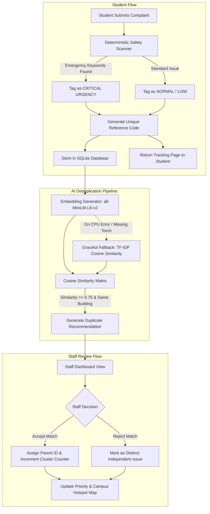

# CampusFix AI — Architecture & Technical Design

## 1. System Architecture

CampusFix AI is an intelligent, human-in-the-loop university maintenance dispatch and deduplication engine.



---

## 2. Database Schema Specification (SQLite)

### Table: `complaints`
| Column | Type | Description |
|---|---|---|
| `id` | INTEGER PRIMARY KEY AUTOINCREMENT | Unique complaint ID |
| `reference_code` | TEXT UNIQUE NOT NULL | Human-friendly tracking code (e.g., `CFX-2026-9041`) |
| `title` | TEXT NOT NULL | Short issue title (e.g., "Broken AC in Room 204") |
| `description` | TEXT NOT NULL | Detailed description from student |
| `building` | TEXT NOT NULL | Campus location (e.g., "Engineering Block A", "Library") |
| `room` | TEXT | Specific room or landmark |
| `category` | TEXT NOT NULL | "Electrical", "Plumbing", "HVAC", "Furniture", "Cleanliness", "Safety" |
| `urgency` | TEXT NOT NULL DEFAULT 'Normal' | "Critical", "High", "Normal", "Low" |
| `safety_hazard` | INTEGER DEFAULT 0 | 1 if emergency keywords detected, 0 otherwise |
| `status` | TEXT NOT NULL DEFAULT 'Submitted' | "Submitted", "Under Review", "In Progress", "Resolved" |
| `parent_id` | INTEGER DEFAULT NULL | References `complaints(id)` if clustered as duplicate |
| `duplicate_count` | INTEGER DEFAULT 1 | Total number of reports linked to this canonical issue |
| `created_at` | TIMESTAMP DEFAULT CURRENT_TIMESTAMP | Submission timestamp |
| `updated_at` | TIMESTAMP DEFAULT CURRENT_TIMESTAMP | Last status change timestamp |

---

## 3. Duplicate Detection & AI Pipeline

### A. Fast-Path Safety Scanner (Deterministic)
Before computing vector embeddings, the text is scanned against high-priority safety keywords:
* **Trigger terms**: `spark`, `exposed wire`, `gas leak`, `flooding`, `smoke`, `fire`, `ceiling collapse`, `broken glass`, `shock`.
* **Action**: Sets `safety_hazard = 1` and `urgency = 'Critical'`. Flags prominently on the staff board.

### B. Embedding & Semantic Similarity Engine
* **Primary Model**: `sentence-transformers/all-MiniLM-L6-v2` (running locally on CPU).
* **Comparison Scope**: Only compare against unresolved complaints within the **same building** or campus zone to prevent false-positive cross-campus matches.
* **Similarity Threshold**:
  * $\ge 0.80$: High-confidence duplicate recommendation.
  * $0.65 - 0.79$: Possible duplicate (staff suggested).
  * $< 0.65$: Distinct issue.
* **Fault-Tolerant Fallback**:
  ```python
  try:
      from sentence_transformers import SentenceTransformer
      # Load and compute embeddings
  except Exception as e:
      # Fallback to TF-IDF vectorizer or rapid keyword overlap
  ```

---

## 4. UI / UX Design & Navigation

* `/` — Public Landing Page (Product introduction, system status, quick navigation).
* `/submit` — Student Complaint Submission Form (Instant validation, auto-reference code generator).
* `/track/<reference_code>` — Student Issue Tracker (Real-time status updates without needing an account).
* `/staff` — Maintenance Staff Dashboard:
  * Prioritized cluster list (sorted by duplicate count + urgency flag).
  * AI Duplicate Review modal: shows candidate duplicates, similarity score, and `[Confirm Grouping]` / `[Keep Separate]` actions.
* `/analytics` — Building Hotspot View (Issues by building, resolution rate, top reported categories).
