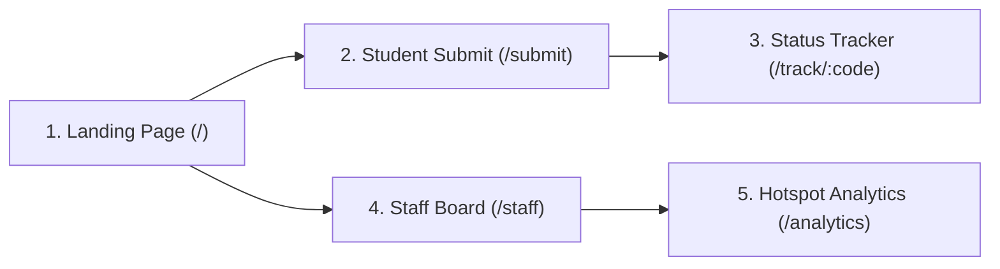

# CampusFix AI — Semantic Design System & UI/UX Specification

> **Design Truth Document**: This file defines the visual language, design tokens, component anatomy, micro-interactions, and screen choreography for CampusFix AI. It contains strictly design-related specifications.

---

## 1. Visual Theme & Atmosphere

* **Atmospheric Philosophy**: *"Academic Precision meets Modern Utility"*
* **Mood**: Crisp, trustworthy, purpose-driven, and reassuring during emergencies. Avoid playful/childish UI elements; emphasize clean structural clarity inspired by high-craft developer tools (Linear, Apple HIG, Vercel).
* **Spatial Density**: **Compact-Comfortable**. Dense enough for maintenance staff to scan 20 tickets without endless scrolling, yet spacious enough for students on mobile devices to report urgent issues in under 30 seconds.
* **Surface Concept**: Layered white paper cards atop a subtle alabaster canvas, structured with clean hairline borders instead of heavy drop shadows.

---

## 2. Semantic Color Palette & Tokens

All color combinations strictly comply with **WCAG 2.1 AA** (minimum 4.5:1 contrast for normal text, 3:1 for graphical elements).

### A. Base Surfaces & Layout
| Token Name | Hex Code | Visual Character | Functional Role |
|---|---|---|---|
| `--color-canvas-bg` | `#F8FAFC` | Alabaster Off-White | Page background canvas |
| `--color-card-bg` | `#FFFFFF` | Pure White | Elevated card, modal, and input surface |
| `--color-border-subtle` | `#E2E8F0` | Whisper Slate | Standard card and container borders |
| `--color-border-muted` | `#CBD5E1` | Mid-Tone Slate | Form input resting borders and dividers |
| `--color-zebra-bg` | `#F1F5F9` | Ice Mist Slate | Table alternating rows and subtle tabs |

### B. Typography & Text Contrast
| Token Name | Hex Code | Visual Character | Functional Role |
|---|---|---|---|
| `--color-text-primary` | `#0F172A` | Deep Ink Slate | Headings, primary labels, maximum contrast |
| `--color-text-body` | `#334155` | Charcoal Slate | Body paragraphs, standard text |
| `--color-text-muted` | `#64748B` | Ash Slate | Timestamps, metadata, input placeholders |
| `--color-text-inverse` | `#FFFFFF` | Crisp White | Text on dark buttons and filled badges |

### C. Brand & Interactive Accents
| Token Name | Hex Code | Visual Character | Functional Role |
|---|---|---|---|
| `--color-brand-primary` | `#1D4ED8` | Academic Cobalt | Primary action buttons, active navigation links |
| `--color-brand-hover` | `#1E40AF` | Deep Navy Cobalt | Primary hover and active states |
| `--color-brand-wash` | `#EFF6FF` | Soft Cobalt Tint | Selected card backgrounds, active badge halos |
| `--color-brand-focus-ring` | `rgba(37, 99, 235, 0.25)` | 3px Electric Glow | Accessible keyboard focus indicator |

### D. Semantic Status & Urgency Roles
| State | Solid Hex | Soft Wash Hex | Border Hex | Functional Meaning |
|---|---|---|---|---|
| **Critical Hazard** | `#DC2626` (Crimson) | `#FEF2F2` | `#FECACA` | Safety hazard (sparks, gas, leaks, exposed wires) |
| **High Urgency** | `#D97706` (Amber) | `#FFFBEB` | `#FDE68A` | Duplicate clusters $\ge 5$, blocked facilities |
| **In Progress** | `#2563EB` (Cobalt) | `#EFF6FF` | `#BFDBFE` | Maintenance crew dispatched / working |
| **Resolved** | `#059669` (Emerald) | `#ECFDF5` | `#A7F3D0` | Issue resolved & verified by staff |
| **AI Suggested** | `#7C3AED` (Violet) | `#F5F3FF` | `#DDD6FE` | AI duplicate match candidate (awaits staff review) |

---

## 3. Typography System

* **Font Family Stack**:
  ```css
  font-family: -apple-system, BlinkMacSystemFont, "SF Pro Text", "Inter", "Segoe UI", Roboto, sans-serif;
  ```
* **Letter Tracking**: Negative letter-spacing (`letter-spacing: -0.025em`) on all headings to provide modern visual tightness and authority.

### Typographic Scale
| Level | Font Size | Line Height | Weight | Tracking | Usage |
|---|---|---|---|---|---|
| **Hero Display** | `40px` (`2.5rem`) | `1.15` | `800` (Extrabold) | `-0.03em` | Main landing headline |
| **Page Title (H1)** | `28px` (`1.75rem`) | `1.25` | `700` (Bold) | `-0.025em` | Dashboard & form page headers |
| **Section Header (H2)** | `20px` (`1.25rem`) | `1.30` | `600` (Semibold) | `-0.02em` | Card titles, modal headers |
| **Item Header (H3)** | `16px` (`1.0rem`) | `1.40` | `600` (Semibold) | `-0.01em` | Ticket titles, list item titles |
| **Body Standard** | `15px` (`0.9375rem`) | `1.55` | `400` (Regular) | `0` | Descriptions, instructions |
| **Meta / Caption** | `13px` (`0.8125rem`) | `1.40` | `500` (Medium) | `+0.01em` | Timestamps, building/room tags |
| **Micro Badge / Monospace** | `11px` (`0.6875rem`) | `1.20` | `700` (Bold) | `+0.06em` | Tracking IDs (`CFX-9041`), status chips (All-Caps) |

---

## 4. Spacing, Geometry & Elevation Tokens

### A. 4px Spacing Grid
* `space-1`: `4px` | `space-2`: `8px` | `space-3`: `12px` | `space-4`: `16px`
* `space-6`: `24px` | `space-8`: `32px` | `space-12`: `48px` | `space-16`: `64px`

### B. Border Radius Tokens
* **Pill (`9999px`)**: Interactive buttons, priority count badges, status tags.
* **Card (`14px`)**: Content cards, statistics widgets, dashboard panels.
* **Control (`10px`)**: Text inputs, dropdown select boxes, textareas.
* **Micro (`6px`)**: Tooltips, small code pills, inline labels.

### C. Elevation & Depth Tokens
Avoid dark muddy drop shadows. Use dual-layer, diffused slate illumination:
```css
/* Level 0: Resting Flat (Structural 1px border) */
--elevation-0: none;

/* Level 1: Default Surface Card */
--elevation-1: 0 1px 3px 0 rgba(15, 23, 42, 0.04), 0 1px 2px -1px rgba(15, 23, 42, 0.04);

/* Level 2: Card Hover / Interactive Lift */
--elevation-2: 0 10px 20px -3px rgba(15, 23, 42, 0.06), 0 4px 6px -4px rgba(15, 23, 42, 0.03);

/* Level 3: Floating Modals & Dropdowns */
--elevation-3: 0 20px 25px -5px rgba(15, 23, 42, 0.09), 0 8px 10px -6px rgba(15, 23, 42, 0.04);
```

---

## 5. Component Styling Specifications

### A. Buttons
* **Primary Button**:
  * Surface: Solid `--color-brand-primary` (`#1D4ED8`)
  * Shape: Pill-shaped (`border-radius: 9999px`)
  * Typography: 14px Semibold, white text
  * Micro-detail: Subtle inset top highlight (`box-shadow: inset 0 1px 0 0 rgba(255, 255, 255, 0.2)`)
  * Hover: Shifts to `#1E40AF` with `-1px` vertical lift
* **Secondary / Outline Button**:
  * Surface: Transparent with 1px `--color-border-subtle`
  * Text: `--color-text-primary` (`#0F172A`)
  * Hover: Background tint `--color-zebra-bg` (`#F1F5F9`)
* **Hazard Action Button**:
  * Surface: Solid `#DC2626` for immediate emergency triage

### B. Form Inputs & Textareas
* Surface: Solid White (`#FFFFFF`) with 1px border `--color-border-muted` (`#CBD5E1`)
* Radius: Control (`10px`)
* Padding: `10px 14px`
* Typography: 15px Regular
* **Focus State**:
  * Border color transitions to `--color-brand-primary` (`#1D4ED8`)
  * Accessible outer glow: `box-shadow: 0 0 0 3px rgba(37, 99, 235, 0.18)`

### C. The "Volume Signal" Priority Badge (Core Differentiator)
Shows maintenance staff how many students reported the exact same problem:
* **Appearance**: Pill badge with an icon and bold counter:
  * Count = 1: Subtle slate badge (`1 report`)
  * Count 2–4: Cobalt badge (`3 students reported this`)
  * Count $\ge$ 5: Amber badge with fiery flame icon (`🔥 12 students reported this`)
* **Typography**: 12px Semibold, high contrast.

### D. The Emergency Hazard Badge
* **Appearance**: Crimson wash background (`#FEF2F2`) with solid crimson border (`#FECACA`) and crimson bold text (`#DC2626`).
* **Icon**: Flashing danger triangle `bi bi-exclamation-triangle-fill`.

### E. Student Status Resolution Stepper
Visual 4-step progress tracker on `/track/<reference_code>`:
1. `Submitted` (Circle 1) $\longrightarrow$
2. `Triaged & Clustered` (Circle 2) $\longrightarrow$
3. `Maintenance In Progress` (Circle 3) $\longrightarrow$
4. `Resolved & Verified` (Circle 4)
* **Active Node**: Solid Cobalt with pulsing ring.
* **Completed Node**: Emerald checkmark `bi bi-check-lg`.
* **Pending Node**: Muted Slate ring with empty center.

---

## 6. Micro-Interactions & "Design Spells"

Small, delightful details that make the application feel premium and responsive:

### Spell 1: Typeahead Duplicate Warning Peek
* **Trigger**: When a student enters their complaint title (e.g., *"AC leaking in Library 2nd floor"*).
* **Behavior**: If a matching active issue exists, a soft accordion panel gently expands below the input with a light animation:
  * *"Notice: 4 students already reported this issue in the Library."*
  * Direct action button: `[+ Add My Voice to Existing Report]` instead of submitting a redundant ticket.

### Spell 2: Emergency Safety Beacon Pulse
* **Trigger**: A report containing safety keywords (`exposed wire`, `gas smell`, `sparks`).
* **Behavior**: A subtle, non-intrusive 2-second breathing pulse animation on the badge border:
  ```css
  @keyframes safety-beacon {
    0%, 100% { box-shadow: 0 0 0 0 rgba(220, 38, 38, 0.4); }
    50% { box-shadow: 0 0 0 6px rgba(220, 38, 38, 0); }
  }
  .safety-pulse { animation: safety-beacon 2.4s infinite ease-in-out; }
  ```

### Spell 3: Staff Cluster Deck Card Merge
* **Trigger**: Staff clicks `[Accept AI Duplicate Match]`.
* **Behavior**: The candidate card smoothly slides leftward, fading into the parent card while the parent card's counter ticks upward (`+1`) with a green micro-badge pop.

### Spell 4: One-Click Reference Code Copy
* **Trigger**: Student clicks their reference code (`CFX-2026-9041`).
* **Behavior**: Code copies to clipboard, icon transitions from `bi-clipboard` to `bi-check2`, and a whisper toast appears: *"Tracking link copied!"*

---

## 7. Screen Layouts & Visual Choreography



### Screen 1: Landing Page (`/`)
* **Hero Section**: Large typography, clean subtext, two pill buttons: Primary *"Report an Issue"*, Secondary *"Staff Dashboard"*.
* **Live Campus Pulse Card**: Floating top-right widget displaying live metrics:
  * Total Reports Active | Duplicates Clustered | Average Resolution Hours.
* **Feature Grid**: 3-column card layout detailing Duplicate Grouping, Safety Escalation, and Student Tracking.

### Screen 2: Student Report Submission (`/submit`)
* **Layout**: Centered, distraction-free container (`max-width: 680px`).
* **Header**: Encouraging title with estimated time: *"Report an Issue (Takes 45 seconds)"*.
* **Form Fields**:
  1. Campus Building (Dropdown with searchable buildings).
  2. Room / Location Detail (Text input).
  3. Issue Category (Visual selectable cards with icons: HVAC, Electrical, Plumbing, Furniture, Safety).
  4. Issue Title & Description (With live duplicate warning peek).
* **CTA**: Full-width high-contrast submit button.

### Screen 3: Issue Tracker (`/track/<reference_code>`)
* **Layout**: Clean receipt-style card.
* **Top Bar**: Large Reference Code with 1-click copy badge.
* **Timeline**: 4-step visual stepper showing exact status, timestamp of last update, and staff notes.
* **Duplicate Status**: Clean notice: *"Your report is linked with 8 other reports for this location. Priority has been escalated."*

### Screen 4: Staff Maintenance Triage Board (`/staff`)
* **Layout**: Two-column layout:
  * **Left Column (Primary Queue)**: Cards grouped by canonical issue, sorted by Priority (Urgent safety first, highest duplicate volume second).
  * **Right Column (AI Duplicate Review Deck)**: Cards flagged by AI with similarity score pills (`88% Similarity Match`). Contains quick `[Confirm Grouping]` and `[Keep Separate]` buttons.

### Screen 5: Campus Hotspot Heatmap (`/analytics`)
* **Layout**: Analytics dashboard with visual cards:
  * Top Problem Buildings (Bar chart / progress bars).
  * Category Breakdown (HVAC vs Plumbing vs Electrical).
  * Duplication Efficiency Metric: *"340 student reports consolidated into 42 actionable repair jobs."*

---

## 8. Accessibility & Ergonomics Standards

* **Focus Rings**: Mandatory 2px offset focus ring on all interactive elements (`:focus-visible`).
* **Text Zoom**: Layout supports up to 200% text zoom without breaking horizontal containers.
* **Reduced Motion**: Respects user preferences:
  ```css
  @media (prefers-reduced-motion: reduce) {
    *, ::before, ::after {
      animation-duration: 0.01ms !important;
      transition-duration: 0.01ms !important;
    }
  }
  ```
* **Color Independence**: Status information is never conveyed by color alone; every status chip includes both an icon and clear text (`[!] Critical`, `[✓] Resolved`).
